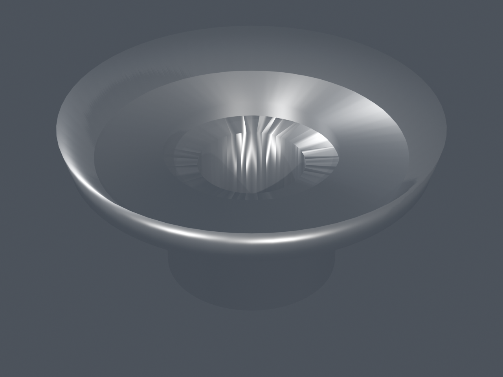
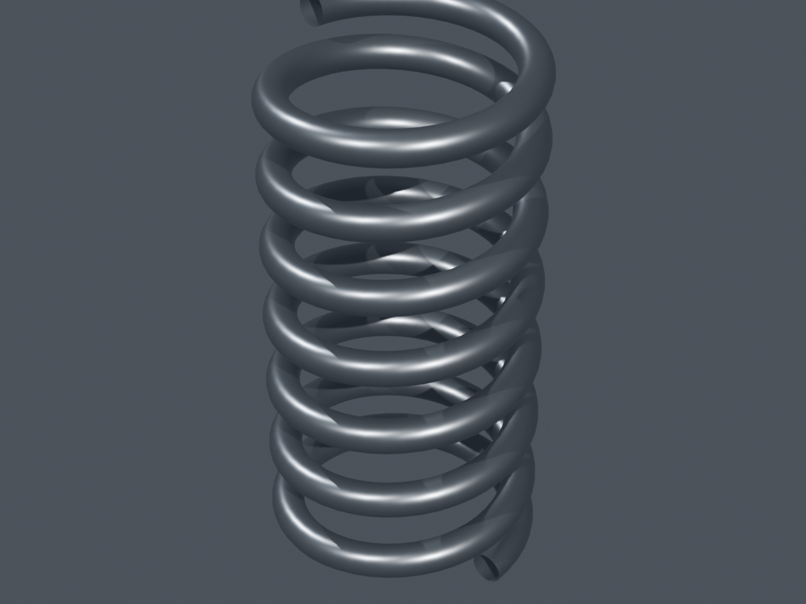
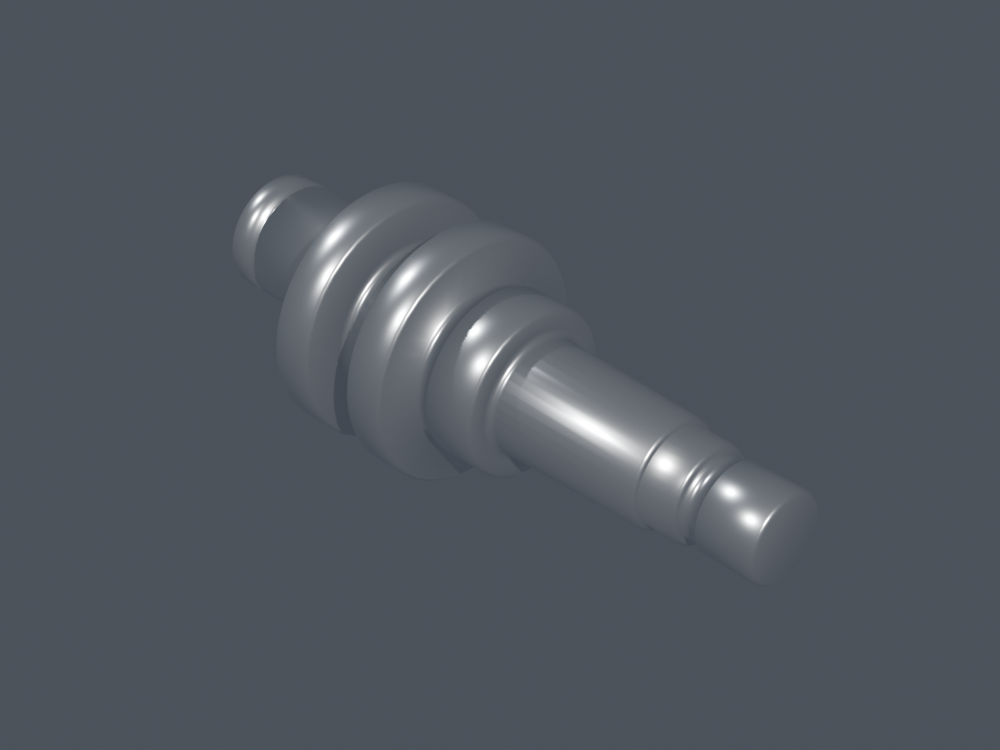
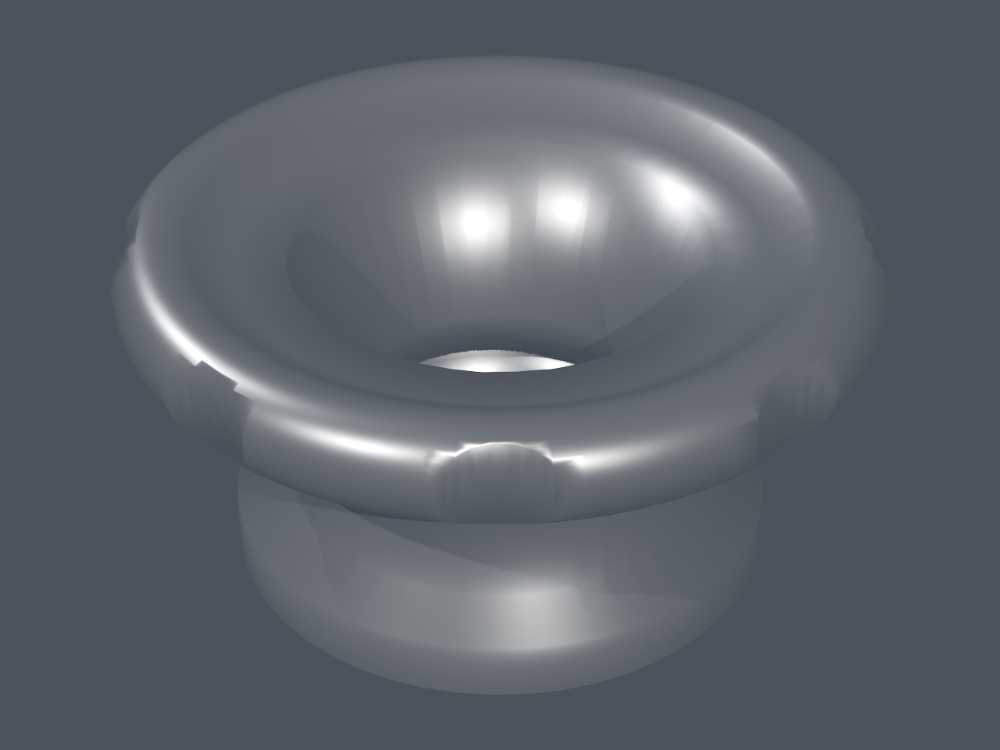
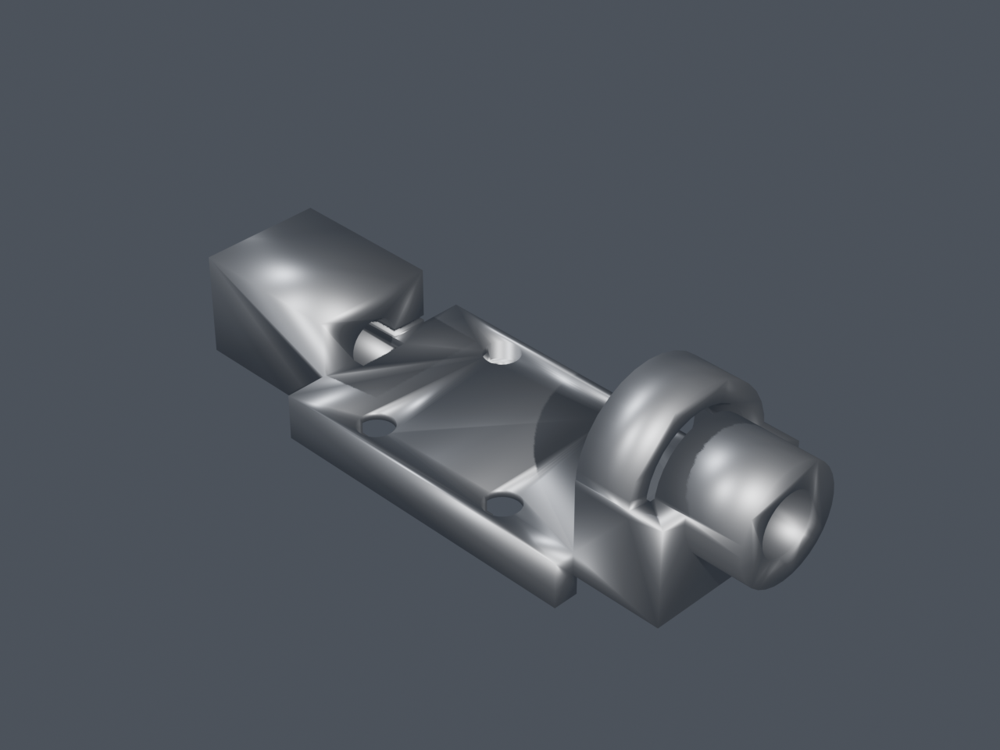
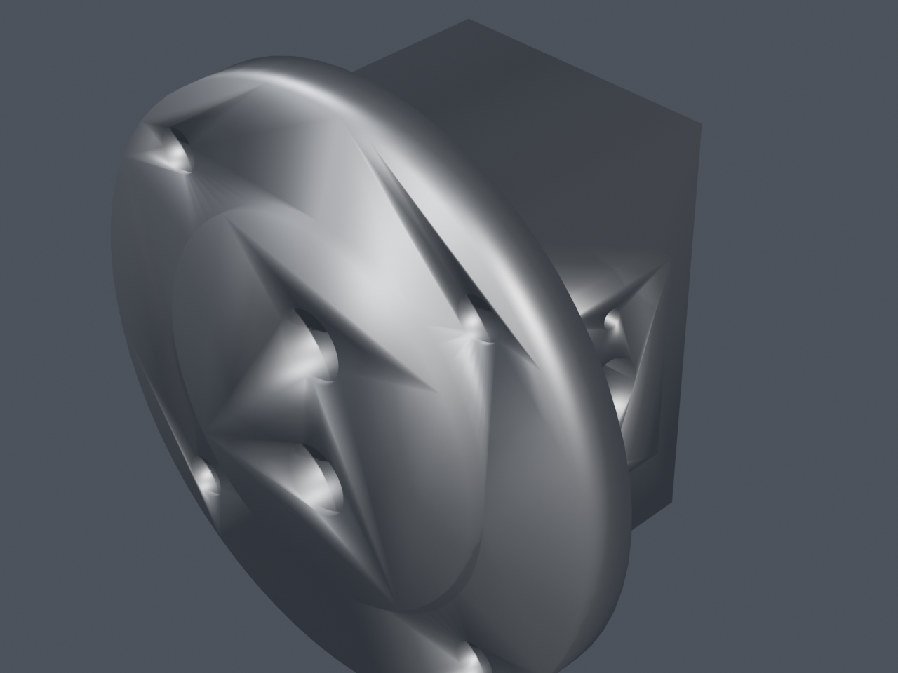

# 《新标准机械图图集》全书 194 件机械零件三维模型工程
# 194 Mechanical Parts 3D CAD Atlas (Blender Procedural Generation)

[](https://www.blender.org/)
[](https://www.python.org/)
[-brightgreen.svg)]()
[]()

> **项目概述 / Project Overview**:
> 本项目基于经典机械工程权威图集《新标准机械图图集》（王静 编著），利用 **Blender 5.2 Python API (`bpy` / `bmesh`)** 进行全自动化程序化三维 CAD 几何建模，将全书收录的 **全部 194 种机械零件** 完整转换为标准三维 `.blend` 模型工程文件，并为每一个零件配置专属工业影棚摄影灯光、物理 PBR 材质（灰铸铁、机加工碳钢、青铜、弹簧钢）与 1280x960 高清渲染预览图。
>
> This repository contains the complete collection of **all 194 mechanical parts** from the authoritative Chinese engineering drawing atlas *"New Standard Mechanical Drawings Collection"* (edited by Wang Jing). All models are procedurally generated using Blender 5.2 Python (`bpy`/`bmesh`), featuring exact parametric dimensions from original orthographic drawings, cross-validated 3D isometric topologies from Appendix A, realistic studio lighting, PBR materials, and 1280x960 preview renders.

---

## 📊 分类统计与完工状态 / Category Breakdown & Progress

| 类别编号 / Cat | 类别名称 / Category Name | 零件数量 / Count | 建模完成率 / Progress | 模型文件目录 / Directory |
| :---: | :--- | :---: | :---: | :--- |
| **01** | **齿轮类零件 (Gears)** | 10 | **100% (10/10)** | [`01_齿轮类_Gears/`](./01_齿轮类_Gears/) |
| **02** | **弹簧类零件 (Springs)** | 5 | **100% (5/5)** | [`02_弹簧类_Springs/`](./02_弹簧类_Springs/) |
| **03** | **轴套类零件 (Shafts & Sleeves)** | 40 | **100% (40/40)** | [`03_轴套类_Shafts_Sleeves/`](./03_轴套类_Shafts_Sleeves/) |
| **04** | **轮盘盖类零件 (Discs, Pulleys & Covers)** | 48 | **100% (48/48)** | [`04_轮盘盖类_Discs_Covers/`](./04_轮盘盖类_Discs_Covers/) |
| **05** | **叉架类零件 (Forks, Brackets & Levers)** | 46 | **100% (46/46)** | [`05_叉架类_Forks_Brackets/`](./05_叉架类_Forks_Brackets/) |
| **06** | **箱壳类零件 (Housings & Casings)** | 45 | **100% (45/45)** | [`06_箱壳类_Housings/`](./06_箱壳类_Housings/) |
| **总计** | **全书六大类别汇总 (Grand Total)** | **194** | **100.0% (194/194)** | **全部完成 / Fully Complete** |

详见完整的零件清单与图纸页码对照表：[**PARTS_INDEX.md**](./PARTS_INDEX.md) 和 [**parts_manifest.json**](./parts_manifest.json)。

---

## 🌟 核心特性 / Key Features

1. **精准几何与公差尺寸 / Parametric Dimensions & Tolerances**:
   - 严苛遵循原书二维工程图尺寸标注，包括基准面、孔心距、配合公差（H6/H7/H8/H9等）、螺纹配合（公制螺纹与管螺纹）、密封环槽、倒角与圆角。
   - All models adhere strictly to engineering dimensions, tolerances, bore limits, screw threads, keyways, and chamfers specified in the textbook.

2. **空间拓扑双重校验 / Dual Validation with Appendix A**:
   - 结合附录 A（P235~P255）三维立体透视图，针对铸件分型面、拔模斜度、加强筋肋、减重凹槽等复杂空间曲面进行精确重建。
   - Cross-referenced with Appendix A 3D isometric reference drawings for complex casting drafts, webs, ribs, and cavities.

3. **物理 PBR 材质与自动平滑 / Realistic PBR Materials & Shading**:
   - **铸铁 (Cast Iron)**: 模拟未加工铸造粗糙表面微质感与暗金属光泽。
   - **机加工钢 (Machined Steel)**: 模拟精车/磨削后的高反光金属质感。
   - **青铜 (Bronze)**: 模拟蜗轮与耐磨轴套的暖金铜质感。
   - **弹簧钢 (Spring Steel)**: 模拟冷拔弹簧钢丝表面微哑光质感。
   - 全面启用法线自动平滑（Auto Smooth），消除低多边形切面感。

4. **自动化影棚渲染 / Studio Lighting & Automated Camera**:
   - 自动计算零件三维包围盒（Bounding Box），自适应调整相机距离与三点式影棚光照（Key / Fill / Rim Light）。
   - 批量输出 194 张 1280x960 统一视角的无畸变渲染预览图存放在 [`Renders/`](./Renders/) 目录。

---

## 🖼️ 零件精选展示 / Showcase Gallery

| 01. 齿轮类 (LJT01.07 锥齿轮) | 02. 弹簧类 (LJT02.01 压缩弹簧) | 03. 轴套类 (LJT03.12 曲轴) |
| :---: | :---: | :---: |
|  |  |  |

| 04. 轮盘盖类 (LJT04.04 手轮) | 05. 叉架类 (LJT05.29 主轴架) | 06. 箱壳类 (LJT06.28 泵体) |
| :---: | :---: | :---: |
|  |  |  |

---

## 📁 目录结构 / Directory Structure

```text
WangJing-Mechanical-Parts-Atlas-3D/
├── README.md                              # 项目中英双语总说明 / Project Overview
├── PARTS_INDEX.md                         # 194 零件全图纸页码索引表 / Detailed Parts Index
├── parts_manifest.json                    # 零件机器可读元数据库 / Machine-readable JSON Manifest
├── .gitignore                             # Git 忽略配置 / Git Ignore Rules
│
├── 01_齿轮类_Gears/                       # 10 个齿轮类 .blend 模型文件 (LJT01.01 ~ LJT01.10)
├── 02_弹簧类_Springs/                     # 5 个弹簧类 .blend 模型文件 (LJT02.01 ~ LJT02.05)
├── 03_轴套类_Shafts_Sleeves/              # 40 个轴套类 .blend 模型文件 (LJT03.01 ~ LJT03.40)
├── 04_轮盘盖类_Discs_Covers/              # 48 个轮盘盖类 .blend 模型文件 (LJT04.01 ~ LJT04.48)
├── 05_叉架类_Forks_Brackets/              # 46 个叉架类 .blend 模型文件 (LJT05.01 ~ LJT05.46)
├── 06_箱壳类_Housings/                    # 45 个箱壳类 .blend 模型文件 (LJT06.01 ~ LJT06.45)
│
├── Renders/                               # 194 张 1280x960 高清渲染预览图
│   ├── LJT01.01_圆柱直齿轮.png
│   └── ... (共 194 张 PNG 预览图)
│
├── Drawing_Sheets/                        # 提取自原图集的工程图与附录参考图
│   └── Reference_Crops/                   # 194 个零件的高清立体图裁剪切片
│
└── Scripts/                               # Blender Python 自动化程序化生成脚本
    ├── blender_cad_generator.py           # 核心 CAD 建模与渲染工具库
    ├── update_index.py                    # 索引与 Manifest 状态同步脚本
    ├── generate_cat01_gears.py            # 第 01 类建模脚本
    ├── generate_cat02_springs.py          # 第 02 类建模脚本
    ├── generate_cat03_batch1.py ...       # 第 03 类批次建模脚本
    ├── generate_cat04_batch1.py ...       # 第 04 类批次建模脚本
    ├── generate_cat05_batch1.py ...       # 第 05 类批次建模脚本
    ├── generate_cat06_batch1.py           # 第 06 类第 1 批次脚本 (15 parts)
    ├── generate_cat06_batch2.py           # 第 06 类第 2 批次脚本 (15 parts)
    └── generate_cat06_batch3.py           # 第 06 类第 3 批次脚本 (15 parts)
```

---

## 🛠️ 使用与二次开发指南 / How to Use & Generate

### 1. 软件环境需求 / Prerequisites
- **Blender 4.0+ 或 5.x LTS**（推荐 Blender 5.2+）
- **Python 3.10+**（用于运行元数据同步与辅助分析工具）

### 2. 打开与查看三维模型 / Inspect Models in Blender
任意单个零件均可直接在 Blender 中双击打开查看：
```bash
# 使用命令行打开任意模型（例如 LJT06.28 泵体）
blender "06_箱壳类_Housings/LJT06.28_泵体.blend"
```
模型已配置：
- 默认置于三维世界原点（Origin）。
- 已配置完整的修改器堆栈与物理材质着色树。
- 场景内已预置透视摄像机与工业三点布光系统。

### 3. 无头模式自动化重新生成与渲染 / Headless Regeneration
如需重新生成某一类别的所有模型并更新渲染图，可在无头命令行模式下调用 Blender 执行对应脚本：
```bash
# 重新生成第 06 大类第 3 批次零件
blender -b -P "Scripts/generate_cat06_batch3.py"

# 更新索引状态
python "Scripts/update_index.py"
```

---

## 📜 许可证与致谢 / License & Acknowledgments
- **3D Models & Procedural Code**: [MIT License](./LICENSE)
- **Reference Atlas**: 本项目模型图纸参考自《新标准机械图图集》（王静 编著，中国科学技术出版社）。原图书知识产权归原作者及出版社所有，本项目三维建模仅供数字化机械制图学习、CAD 教学及三维可视化技术交流使用。
